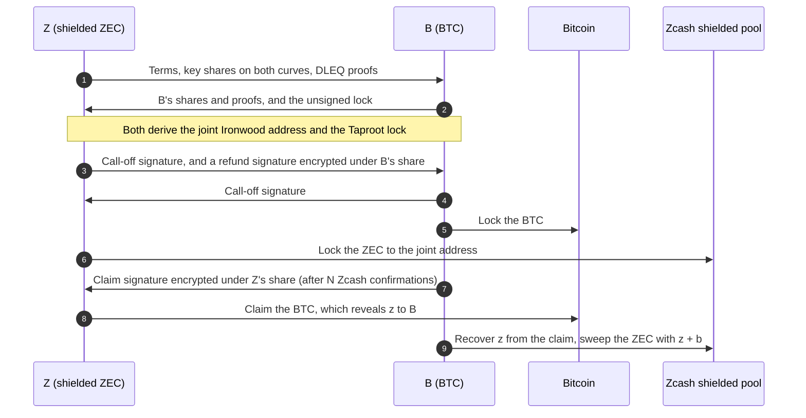
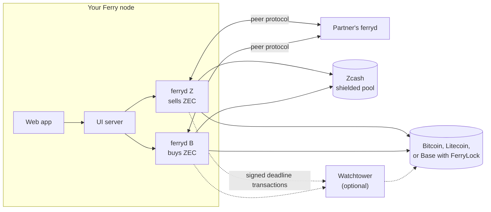

# Ferry

**Swap shielded ZEC for BTC, LTC, USDC or WETH, peer to peer. No bridge, no custodian, and the ZEC
never leaves the shielded pool.**

[What is real](docs/WHAT-IS-REAL.md) · [How a swap works](#how-a-swap-works) ·
[Architecture](#architecture) · [Privacy](#privacy) · [Protocol](docs/PROTOCOL.md) ·
[Threat model](docs/THREAT-MODEL.md) · [Run a node](docs/RUN-A-NODE.md)

<!-- Public demo: add its URL to the line above once it is live. -->

Ferry is a trustless atomic swap between shielded Zcash and other chains. The ZEC is locked to a
shielded key split between the two parties, and claiming the other coin reveals the missing half.
Nobody ever holds both coins, either side can walk away with its own, and every ZEC transaction
stays inside Zcash's shielded pool (Ironwood).

Built for the [Zecathon](https://thezecathon.com) **Cross-chain** track: *swaps, bridges and intents
that reach other chains without unshielding on the way through.*

> **For judges:** start with [what is real and what is a mock](docs/WHAT-IS-REAL.md), which links
> the public transactions of every live swap. Then
> [why not NEAR Intents, Maya or THORChain for the ZEC side](docs/WHAT-IS-REAL.md#why-not-near-maya-or-thorchain-for-the-zec-side)
> and the [known limits](#known-limits).

## Contents

- [Highlights](#highlights)
- [Why Ferry](#why-ferry)
- [How a swap works](#how-a-swap-works)
- [Architecture](#architecture)
- [Privacy](#privacy)
- [What has run](#what-has-run)
- [Try it](#try-it)
- [Status and known limits](#status-and-known-limits)
- [Documentation](#documentation)

## Highlights

- **Shielded end to end.** The ZEC moves from one Ironwood note to another, with no transparent
  address and no Sapling or Orchard part. Ferry refuses to build anything else, and the end-to-end
  test checks every ZEC transaction as mined.
- **Trustless.** No bridge, custodian, committee or Ferry server holds funds. Each side gets the
  other coin or its own back; deadlines and a penalty deal with anyone who vanishes.
- **Ordinary on Bitcoin.** When a swap goes to plan, its lock and claim look like a single-key
  Taproot payment and spend: one 64-byte signature, no script revealed, and no hash shared with
  Zcash.
- **Four coins.** BTC and LTC through the same Taproot transactions; USDC and WETH on Base through
  `FerryLock`, a small contract.
- **Both directions.** Sell ZEC for a coin, or buy shielded ZEC with one: the swap card flips
  between them.
- **Live on public test networks.** [17 swaps](#what-has-run) with real shielded notes on Zcash
  testnet, Bitcoin signet, Litecoin testnet and Base Sepolia, each with public transactions.
- **Backstops at the deadlines.** A watchtower can act at the deadlines for an offline party, and a
  child-pays-for-parent fee bump (off by default) can push a stuck Bitcoin or Litecoin claim,
  refund or penalty through.
- **Reach without exposure.** Routes chain two swaps through the shielded pool (BTC → shielded ZEC
  → USDC, say), and a sale can pay straight into a NEAR Intents deposit address. The ZEC itself
  never goes to NEAR.

## Why Ferry

Every way between ZEC and other chains today passes through someone's custody, a transparent
address, or both:

- **Intent networks** (NEAR Intents, and the wallets that use it, such as Zodl's swap) take ZEC at
  transparent addresses only, so a shielded wallet unshields first.
- **Vaults and bridges** (THORChain, Maya, NEAR's bridge) hold the ZEC at transparent addresses.
- **Exchanges** hold your coins during the trade and see both sides of it.

Sources, checked on 2026-10-21, are in
[WHAT-IS-REAL.md](docs/WHAT-IS-REAL.md#why-not-near-maya-or-thorchain-for-the-zec-side).

Monero had the same problem: no scripts, so no hash-locked contracts. Its answer was the
adaptor-signature swap (Gugger, 2020). Ferry brings that construction to Zcash's shielded pool,
and adds Litecoin and EVM tokens as counter-chains.

## How a swap works

Two parties: **Z** holds shielded ZEC and wants the other coin; **B** holds the other coin (BTC,
LTC, USDC or WETH) and wants shielded ZEC. B always locks first. When you sell ZEC you are Z; when
you buy it you are B.

### The idea

1. **Split a Zcash key across two people.** Each party picks a secret share. The ZEC is locked to a
   single-use Ironwood address whose spend authorizing key is the sum of both shares,
   `ask = σ·(z + b)`. Both parties can watch the note; neither can spend it alone.
2. **Prove the same secret lives on both curves.** Each party publishes its share as a point on
   Pallas (Zcash's curve) and on secp256k1 (Bitcoin's), with a cross-group DLEQ proof that the two
   points share one discrete log.
3. **Let the other chain enforce the trade.** The BTC is locked in a Taproot output. B gives Z an
   *adaptor* signature for the claim, encrypted under Z's share. To take the BTC, Z must complete
   it, and from the completed signature on chain B can work out `z`.
4. **Read the key off the chain.** B subtracts the two signatures, recovers `z`, and now holds the
   whole Ironwood key: B sweeps the ZEC to its own shielded address.

### Step by step

Either party can propose the swap; the order of the locks is the same.



The claim spends the lock through Taproot's key path with a MuSig2 adaptor signature, so on chain it
is one signature and no script. The sweep waits a random delay so that it doesn't line up in time
with the claim. Keys, transactions and timing rules: [PROTOCOL.md](docs/PROTOCOL.md). Peer messages
and state machines: [ARCHITECTURE.md](docs/ARCHITECTURE.md).

### If something goes wrong

The BTC lock has two deadlines: after **T1** either side can call the swap off, and after **T2** a
silent BTC holder can be penalised.

| What happens | Z ends up with | B ends up with |
|---|---|---|
| Everything goes to plan | the BTC | the ZEC |
| Z never locks its ZEC | its ZEC (never sent) | its BTC, refunded after T1 |
| Z locks the wrong amount | its ZEC back | its BTC back |
| Z locks, then vanishes | its ZEC back, whenever it returns | its BTC back |
| B locks, then vanishes | the BTC, after T2 | nothing |
| Someone tries to take both | not possible: every way out reveals the share the other side needs, or opens only after a deadline | |

B's refund reveals `b`, which is how Z gets its ZEC back. Ferry enforces the timing rules that make
this safe: Z doesn't claim close to T1, B doesn't refund close to T2, and B refunds only after the
call-off is confirmed. The plain-language version is in
[THREAT-MODEL.md](docs/THREAT-MODEL.md#if-someone-disappears-or-cheats).

### Other coins

- **Litecoin** runs the Bitcoin transactions unchanged: Litecoin Core 0.21.2 and later has Taproot
  with the same rules ([LITECOIN.md](docs/LITECOIN.md)).
- **USDC and WETH on Base** use `FerryLock` ([contracts/src/FerryLock.sol](contracts/src/FerryLock.sol))
  instead of Taproot scripts. B locks the tokens with the swap's terms. Z claims them by revealing
  `z`, which the contract checks with an `ecrecover` trick, and only with B's off-chain EIP-712
  `Ready` signature, the counterpart of the claim signature above. From `t1` B can refund by
  revealing `b`; from `t2` Z can take the penalty ([EVM.md](docs/EVM.md)). It is deployed on Base
  Sepolia at
  [`0x74b7…5Ef`](https://sepolia.basescan.org/address/0x74b775EA7Bc7a2b2688b7A72Da5dee674BBd65Ef).

## Architecture

Each person runs a **Ferry node**: the app, plus one `ferryd` daemon per side of each pair it
trades. A swap is two daemons talking directly, each watching both chains for its own party.



| Part | What it does |
|---|---|
| **ferryd** ([crates/ferryd](crates/ferryd)) | Runs one party of one pair. It negotiates with the partner's ferryd over the peer protocol, watches both chains, signs, keeps one record per swap on disk and acts at the deadlines. A node runs a Z daemon (sells ZEC) and a B daemon (buys it), and each can take several swaps at once. |
| **The app** ([web/src](web/src)) | The swap card (sell or buy, a token picker by chain), live swap progress, activity, the wallet, and pages on how it works, safety, privacy and help. |
| **The UI server** ([web/server](web/server)) | Serves the app and proxies it to the node's daemons, adding each daemon's token so the browser never sees one. It streams swap updates, asks partners for signed firm prices, and talks to NEAR Intents. |
| **Zcash** | `ferry-zec` drives a zcash-devtool wallet against a light-client server (testnet.zec.rocks on the test network; Zebra and Zaino locally). Every transaction is built as a PCZT and checked to be Ironwood-only before it is signed; `ferry-zec-signer` signs with the joint key. |
| **Bitcoin and Litecoin** | The node's own bitcoind or litecoind, over RPC. |
| **Base** | JSON-RPC to the deployed `FerryLock`. ferryd refuses to start unless the contract's code is exactly the one it was built with. |
| **Watchtower** ([crates/ferry-watchtower](crates/ferry-watchtower)) | Optional. Holds an offline party's fully signed call-off, refund or penalty and broadcasts it on time (on Base it calls `FerryLock` instead). It holds no keys on Bitcoin and Litecoin, so it can't redirect coins ([WATCHTOWER.md](docs/WATCHTOWER.md)). |
| **ferry-route** ([crates/ferry-route](crates/ferry-route)) | Optional. Chains a buy and a sell on the node's own two daemons: coin A → shielded ZEC → coin C. Holds no keys and no funds. |

### Prices and partners

Each pair has **partners** (makers): ferryd nodes that publish an offer. When you type an amount,
your UI server rounds it **up** to a size bucket (0.1, 0.25, 0.5, 1, 2.5 … 100 ZEC) and asks the
partners it lists for a signed firm price, good for 45 seconds. The best price is taken, and the
atomic swap settles it, so nobody holds funds in between. Partners see the bucket, not your amount,
and the request carries no address, account or browser IP of yours. Today each pair has one
partner, run by us. ([ARCHITECTURE.md](docs/ARCHITECTURE.md#firm-quotes))

### Routes and NEAR Intents

- **Routes** move value between two other coins through the shielded pool, as two ordinary swaps:
  your B daemon buys ZEC with coin A and sweeps it straight into your Z daemon's wallet, which sells
  it for coin C. Both legs are split into standard sizes, each part its own swap after its own
  random pause, so neither outer chain sees one telling pair of amounts. If the second leg can't
  finish, you keep shielded ZEC ([crates/ferry-route](crates/ferry-route/README.md)).
- **NEAR Intents** adds reach on the coin side. A sale can pay its coin straight into a NEAR Intents
  deposit address (`payout_to`), which delivers any of 205 assets on 37 chains (as of 2026-10-20).
  Ferry never sends ZEC into NEAR Intents, whose ZEC deposit addresses are transparent
  ([ARCHITECTURE.md](docs/ARCHITECTURE.md#cross-chain-settlement-with-near-intents)).

### Code map

| Path | What it is |
|---|---|
| `crates/ferry-core` | The swap itself, free of I/O: terms and timing policy, versioned peer messages, key shares, the joint Ironwood key and the state machines of both roles |
| `crates/ferry-dleq` | Cross-group DLEQ proofs between Pallas and secp256k1 (Serai's `dleq`) |
| `crates/ferry-btc` | Taproot lock and call-off scripts, presigned transactions, MuSig2 and BIP340 adaptor signatures, bitcoind and litecoind RPC |
| `crates/ferry-zec` | The real Zcash leg: the zcash-devtool wallet, joint-key accounts, Ironwood-only PCZTs |
| `crates/ferry-evm` | The Base leg: `FerryLock` client, event watcher, share extraction, the EIP-712 `Ready` signature |
| `crates/ferryd` | The party daemon: peer protocol, chain watchers, persistence, HTTP and SSE API, offers and firm quotes |
| `crates/ferry-watchtower` | The watchtower |
| `crates/ferry-route` | Routes: coin A → shielded ZEC → coin C |
| `contracts/` | `FerryLock.sol` and its Foundry tests |
| `web/` | The app (React) and its server (`web/server`, plain Node) |
| `tools/` | `ferry-zec-signer` (signs Ironwood-only transactions) and `jointkey` (a split Ironwood key, for the end-to-end test) |
| `infra/` | The node installer (`infra/node`), the server deploy (`infra/deploy`), the local regtest stack and the test-network scripts |
| `docs/` | The protocol, architecture, threat model, API and guides ([Documentation](#documentation)) |

## Privacy

### What each chain sees

| | Bitcoin observer | Zcash observer |
|---|---|---|
| Lock | a Taproot output | an Ironwood bundle: amount, sender, receiver and memo encrypted |
| Settle | a key-path spend with one Schnorr signature, like any single-key Taproot payment (a call-off's refund or penalty is a script-path spend) | an Ironwood spend: a nullifier and a fresh randomized key |
| Link between them | none: no shared hash, no shared key, no shared amount | |

Unlike a hash-locked swap, nothing appears on both chains. The scalar revealed on Bitcoin derives
`ak`, but finding the Zcash note also needs `nk` and `rivk`, which only the two parties hold, and
every Ironwood spend shows only `rk = ak + α·G` with a fresh `α`. On Base, the lock and claim are
visibly calls to `FerryLock`.

### What the other side learns

- The amounts and deadlines you agreed on, and that the ZEC arrived at the shared single-use
  address and later left it.
- **Not where the ZEC went.** The sweep is built with its outgoing viewing key discarded, so the
  partner, who holds the shared viewing key, can't read its recipient or amount.
- **Not your wallet:** never your balance, your other addresses or your history.
- Your IP address, because the two daemons talk directly. Use Tor or a VPN if that matters.

### Nothing unshielded, enforced and tested

Before locking, `ferry-zec` refuses unless the Ironwood balance alone covers the swap and the
wallet's proposal touches only Ironwood. It refuses to sign a sweep or reclaim that has any
transparent, Sapling or Orchard part, and it re-checks the lock as broadcast.

`infra/e2e-real.sh` proves it on a fresh regtest Bitcoin + Zebra + Zaino stack with real Ironwood
notes. It runs a swap (while a stranger sends extra notes to the joint address), a refund and a
penalty, and checks that a wallet with too little shielded ZEC is turned away before anything is
locked. It checks that the partner can't see where a sweep went, and a control run without that
protection shows the same check does catch the leak. It exits 0 only if every check passes. Every
ZEC transaction of its 2026-10-19 run, as mined:

| Swap | Transaction | txid | Transparent in/out | Sapling | Orchard | Ironwood actions |
|---|---|---|---|---|---|---|
| happy | ZEC lock | `ad59673a…` | 0 / 0 | 0 | 0 | 5 |
| happy | B's sweep | `4d4914e4…` | 0 / 0 | 0 | 0 | 2 |
| refund | ZEC lock | `90579cad…` | 0 / 0 | 0 | 0 | 2 |
| refund | Z's reclaim | `46ee4dfa…` | 0 / 0 | 0 | 0 | 2 |
| punish | ZEC lock | `1662b575…` | 0 / 0 | 0 | 0 | 2 |

What Ferry still can't hide, and why, is in [THREAT-MODEL.md](docs/THREAT-MODEL.md).

## What has run

Seventeen swaps on public test networks, all with real shielded notes. We ran both sides. The
other coin's transactions can be checked on public explorers; the Zcash side is shielded.

| Swap | Networks | Start to finish | Public transactions |
|---|---|---|---|
| ZEC → USDC, the first live swap (2026-10-20) | Zcash testnet, Base Sepolia | about 7 min | [lock](https://sepolia.basescan.org/tx/0xeac4a050a97702fbca0fb1cf8ad8d4f965549e0612c62e0d85d233182fa926bb), [claim](https://sepolia.basescan.org/tx/0xde25c161c7e9b978de9aed580d12b0530813a460dd543124fbfc345978996aad) |
| Twelve through the public swap card: ZEC → USDC ×2, USDC → ZEC ×2, ZEC → WETH ×8, up to three at once (2026-10-21) | Zcash testnet, Base Sepolia | | calls to [FerryLock](https://sepolia.basescan.org/address/0x74b775EA7Bc7a2b2688b7A72Da5dee674BBd65Ef) |
| WETH → ZEC (2026-10-22) | Zcash testnet, Base Sepolia | 7.5 min | [lock](https://sepolia.basescan.org/tx/0x8d2ba7ed272476ab8585f85dd7fda874bdfaee2c9befa801913ca85ff5f2c365), [claim](https://sepolia.basescan.org/tx/0xdb0b11bd8b7178862bbb015514ff2aebe9ac1b437862474fd8ddade5668029a3) |
| ZEC → BTC (2026-10-23) | Zcash testnet, Bitcoin signet | 14.5 min | [lock](https://mempool.space/signet/tx/f3021217123129e1c55032e1cf5a74557f4aa5b40bd154c6235b5e01405c39f4), [claim](https://mempool.space/signet/tx/472b3d9389133612e644438d5ebfb6326ed747e843034c2dd2c70f4fcd1ef12b) |
| BTC → ZEC (2026-10-23) | Zcash testnet, Bitcoin signet | under 11 min | [lock](https://mempool.space/signet/tx/5dcfc7974129091ccd70fac74836c32f6438798a3f17734e38e4756c97907bcf), [claim](https://mempool.space/signet/tx/a9a288f6113e6050295e15b2033d7fc3f14863f31e782756fbb10da864e969cf) |
| LTC → ZEC (2026-10-23) | Zcash testnet, Litecoin testnet | under 25 min | [lock](https://litecoinspace.org/testnet/tx/e64f6b248c7cdfd8cf7c655be36cef2c324711d8ac21a0eddafd99d764b13cad), [claim](https://litecoinspace.org/testnet/tx/c7e52a8e36fc4b3549034c9256d35bf5210a74d19065d6b15b7fbda3b22403c8) |

Refunds and penalties have run on regtest (Bitcoin and Litecoin) and on a fork of Base Sepolia, not
yet on a public test network. Nothing has run on mainnet. The full record, and every mock used in
development, is in [WHAT-IS-REAL.md](docs/WHAT-IS-REAL.md).

## Try it

### Run your own node

One command starts Ferry on your computer, in Docker, on test networks:

```sh
git clone https://github.com/JemIIahh/ferry.git && cd ferry && ./infra/node/ferry up
```

It asks which pairs to run (ZEC ⇄ USDC on Base Sepolia by default, ready in a minute; Bitcoin
signet and Litecoin testnet sync in the background), creates your wallets locally, builds Ferry
(15–40 minutes the first time) and opens the app at http://127.0.0.1:7865. Then
`./infra/node/ferry addresses` says what to fund and where; `status`, `logs`, `backup`, `update`
and `down` do what they say. There is no "connect wallet": a swap needs key shares and signatures
ordinary wallets can't produce, and someone must be online at the deadlines.
[RUN-A-NODE.md](docs/RUN-A-NODE.md) walks through it in plain language.

### Develop locally

The local regtest stack runs both daemons on one machine: a Bitcoin regtest node in Docker, the
stand-in Zcash chain (ferryd's `--zec mock`: a file both daemons share, with no real notes or
encryption) and a block producer. `ZEC_BACKEND=devtool` runs real shielded ZEC instead (Zebra +
Zaino regtest in Docker), `CHAIN=ltc` runs Litecoin instead of Bitcoin, and `MAKER=z` the buy side.

```bash
infra/regtest.sh up             # bitcoind regtest + stand-in Zcash + two ferryd + block producer
cd web && pnpm install && source ../.demo/env && pnpm dev:ui   # the app against it, at http://localhost:5180
infra/regtest.sh test           # swap, payout, refund and punish through the API, then down
infra/regtest.sh help           # every command, with curl examples
infra/regtest.sh down
cd web && pnpm dev              # the app against mock daemons, no chain needed
```

On public test networks, from your own machine: `infra/testnet.sh` (Bitcoin signet and Zcash
testnet) and `infra/evm-testnet.sh` (Base Sepolia and Zcash testnet; `fork test` rehearses on a
fork of Base Sepolia first, see [EVM.md](docs/EVM.md)). Each has a `help` command.

### Tests

```bash
cargo test                      # unit and simulation tests; the anvil tests run when anvil is installed
cargo test -- --ignored         # tests that need a node: each names it (infra/btc/regtest.sh start,
                                # infra/ltc/regtest.sh start with FERRY_CHAIN=ltc)
infra/e2e-real.sh               # real shielded ZEC on regtest: swap, refund, penalty, and every ZEC
                                # transaction checked for transparent, Sapling or Orchard parts (~10 min)
cd contracts && forge test      # FerryLock, including fuzzing (Foundry)
cd web && pnpm test:server      # the web server
```

### Deploy a server

The public demo runs on one Linux host with Docker Compose and TLS through Caddy:
`infra/deploy/deploy.sh <ssh-host>` from a clone. Requirements, extra pairs, funding, backups and
operations are in [DEPLOY.md](docs/DEPLOY.md).

## Status and known limits

### Status

- **Test networks only.** Zcash testnet with Bitcoin signet, Litecoin testnet and Base Sepolia.
- **Mainnet mode is capped.** `./infra/node/ferry up --mainnet` runs Zcash and Base only, asks for a
  typed confirmation and caps every swap at 0.02 ZEC. No swap has run on mainnet yet.
- **One partner per pair, run by us,** at a fixed demo rate on the public demo. No outside partner
  is listed yet.
- **Several swaps at once:** a node takes up to `--max-swaps` (4 on test networks, 2 on mainnet) as
  far as its free funds go, and answers "busy" past that.

### Known limits

Most of these are the price of having no middleman. Each, with what Ferry does about it and what is
still open, is in [THREAT-MODEL.md](docs/THREAT-MODEL.md#known-limits).

- A partner must be online with the other coin. Today the only partners are ours.
- The second side to lock holds a free option, and no chain can fine whoever walks away: the
  shielded ZEC lock is invisible to the other chain.
- Swaps take minutes (confirmations on both chains) and pay fees on both chains.
- B (the side holding BTC, LTC or tokens) must refund within its window, or delegate it to its own
  [watchtower](docs/WATCHTOWER.md). The tower must stay up (and, on Base, funded for gas). An
  offline Z loses only the trade.
- If B vanishes after Z locks, Z takes B's coin and the ZEC stays locked in the joint address:
  neither side holds the whole key.
- The cross-group DLEQ is Serai's `dleq` under its `experimental` feature, which Serai's 2023 audit
  excluded; its README says "none are recommended". So mainnet is capped at 0.02 ZEC per swap.
- Presigned Bitcoin transactions use fixed fees, so Bitcoin and Litecoin stay on test networks. A
  child-pays-for-parent fee bump is built (`ferryd --bump on`, off by default) but has had no
  outside review; Bitcoin and Litecoin stay off mainnet until it has.
- The joint viewing key is built from an arbitrary `ak`, so it is not quantum-recoverable under
  ZIP 2005 (the same constructor FROST setups use today). The address is single-use and short-lived.

## Documentation

| Document | What's in it |
|---|---|
| [PROTOCOL.md](docs/PROTOCOL.md) | Keys, transactions, the flow, abort cases and timing rules; routes and standard amounts |
| [ARCHITECTURE.md](docs/ARCHITECTURE.md) | Crates, peer messages, state machines, firm quotes, NEAR Intents |
| [THREAT-MODEL.md](docs/THREAT-MODEL.md) | Who you trust, what each side and everyone else learns, known limits (also in the app at `/safety`) |
| [WHAT-IS-REAL.md](docs/WHAT-IS-REAL.md) | What has run and where, with public transactions; what is mocked |
| [EVM.md](docs/EVM.md) | `FerryLock`, USDC and WETH on Base |
| [LITECOIN.md](docs/LITECOIN.md) | Litecoin as the counter-chain |
| [WATCHTOWER.md](docs/WATCHTOWER.md) | The watchtower |
| [API.md](docs/API.md) | ferryd's HTTP API |
| [RUN-A-NODE.md](docs/RUN-A-NODE.md) | Your own node, step by step |
| [DEPLOY.md](docs/DEPLOY.md) | The public demo server |
| [crates/ferry-route](crates/ferry-route/README.md) | Routes: coin A → shielded ZEC → coin C |

## Credits

Gugger, *Bitcoin–Monero Cross-chain Atomic Swap* (2020) · COMIT's xmr-btc-swap · Serai's `dleq` ·
LLFourn's `schnorr_fun` · the Zcash Foundation's frost-tools (`zcash-sign`) and ECC's zcash-devtool.

## License

Licensed under either the [Apache License, Version 2.0](LICENSE-APACHE) or the
[MIT license](LICENSE-MIT), at your option. Code under `third_party/` keeps its own license.
